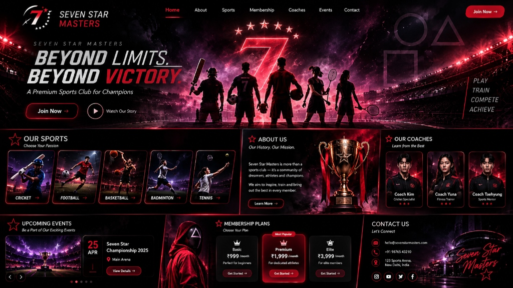

# Seven Star Masters

**Beyond Limits. Beyond Victory.**

Seven Star Masters is a responsive, multi-page website for a sports club and training academy. It brings the club’s sports, membership options, coaches, events, and contact information together in a bold, arena-inspired experience.



## Explore the site

The app includes these routes:

- **Home** (`/`) — club highlights, featured sports, coaches, events, and membership calls to action.
- **About** (`/about`) — the club’s mission, achievements, facilities, and training philosophy.
- **Sports** (`/sports`) — Cricket, Football, Basketball, Badminton, and Tennis.
- **Membership** (`/membership`) — membership tiers, plan comparisons, and a registration interaction.
- **Coaches** (`/coaches`) — coach profiles and booking interaction.
- **Events** (`/events`) — tournaments and event registration interaction.
- **Contact** (`/contact`) — contact information and an interactive contact form.

The interface also includes responsive navigation, reusable cards, modals, animated arena details, and interactive sports and tournament sections.

## Built with

- [React](https://react.dev/) for the UI
- [Vite](https://vite.dev/) for local development and production builds
- [React Router](https://reactrouter.com/) for client-side routing
- [Tailwind CSS](https://tailwindcss.com/) for styling
- [Lucide React](https://lucide.dev/) for icons
- [canvas-confetti](https://www.npmjs.com/package/canvas-confetti) for registration feedback

## Run locally

### Requirements

- Node.js 20.19+ or 22.12+
- npm

### Install and start

```bash
npm install
npm run dev
```

Open the local URL printed by Vite, usually `http://localhost:5173`.

### Available scripts

```bash
npm run dev      # Start the development server
npm run build    # Create a production build in dist/
npm run preview  # Preview the production build locally
npm run lint     # Run ESLint
```

## Project structure

```text
public/            Static images and icons
src/
  assets/          Imported assets
  components/      Shared UI, cards, and modal components
  data/            Club, coach, event, membership, sport, and testimonial content
  pages/           Home, About, Sports, Membership, Coaches, Events, and Contact
  utils/           Shared utilities such as sound effects
  App.jsx          Routes and shared modal state
  main.jsx         React application entry point
```

## Content and forms

Most club and page content is stored in `src/data/` so it can be updated separately from the page components. The membership, booking, event, and contact forms currently provide front-end interactions only; they do not submit information to a server or persist it.

## License

No license is currently specified for this project.
